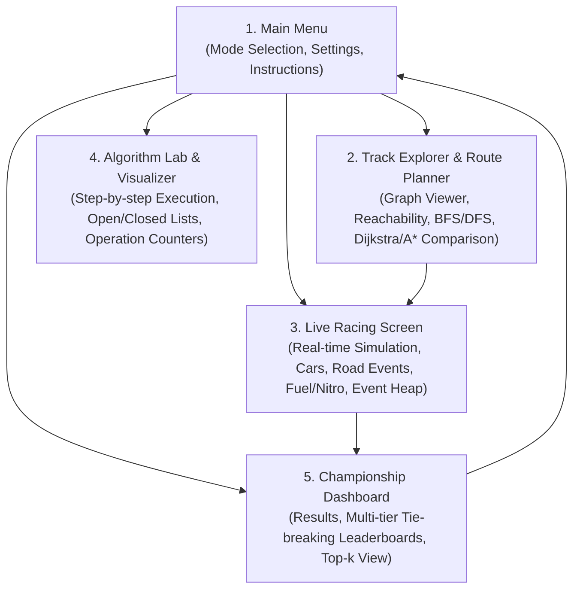
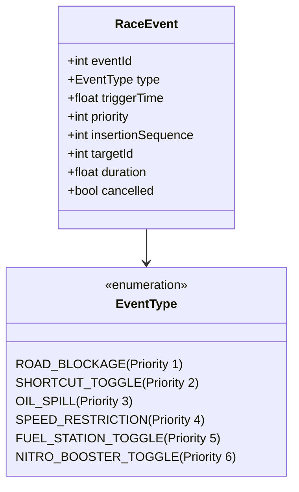
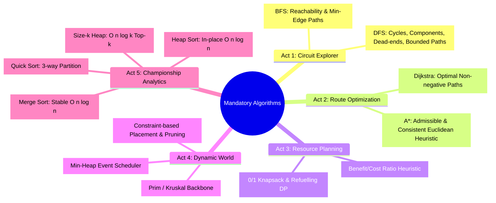

# Smart Racing Championship: Comprehensive Algorithmic & Architectural Analysis
**Course:** Design and Analysis of Algorithms (DAA) — Semester 5  
**Document Ref:** `Project.pdf` (14 Pages)  
**Analysis Date:** November 2026  
**Status:** Complete Architectural Blueprint & Analysis  

---

## 1. Executive Summary & Core Project Philosophy

The **Smart Racing Championship** is a 2D top-down algorithmic racing game situated on a dynamically evolving road network modeled as a directed/undirected graph $G = (V, E)$. The project serves as an end-to-end practical demonstration of core algorithmic paradigms: Graph Traversal, Shortest Paths with Heuristics, Dynamic Programming, Greedy Approximations, Minimum Spanning Trees, Min-Heap Event Scheduling, Backtracking with Constraint Pruning, and Multiple Sorting / Selection Algorithms.

### Core Design Principles
1. **Algorithms First, Not Graphics Shell:** Assessment explicitly emphasizes rigorous problem modeling, provable algorithm correctness, asymptotic complexity analysis, empirical profiling, and clean gameplay integration.
2. **Deterministic, Zero-ML AI:** Machine learning and reinforcement learning are explicitly prohibited. All computer-controlled racers adhere to strict, deterministic rules and state machines.
3. **No Detached Demonstrations ("Single Source of Truth"):** Every mandatory algorithm must play an active, functional role in the live race. The **Algorithm Lab** must execute the *exact same* production algorithm code invoked by the gameplay engine; artificial, detached toy demos are not permitted.
4. **Reproducible Experimental Science:** Algorithms must be subjected to five structured empirical benchmark studies with hardware-isolated timing, operation counters, and raw data logging.

---

## 2. System Architecture & UI/UX Screen Decomposition

The application requires **five distinct GUI screens/modes** structured in an intuitive navigation flow:

### Detailed Screen Specifications

| # | Screen / Mode | Primary Functionality | Required Algorithms / Data Structures |
|---|---------------|-----------------------|---------------------------------------|
| **1** | **Main Menu** | Circuit selection (3 circuits), game mode selection (Championship, Quick Race, Algorithm Lab), difficulty/car settings, rules review. | State machine, navigation controller. |
| **2** | **Track Explorer / Route Planner** | Interactive circuit inspection: select start/target/waypoints; preview reachable checkpoints; compare candidate paths (Distance, Time, Weighted Scalar Cost); inspect alternative routes and shortcuts. | **BFS**, **DFS** (reachability, cycle/dead-end detection, bounded paths), **Dijkstra**, **A\*** (checkpoint-aware). |
| **3** | **Racing Screen** | Real-time top-down 2D simulation: 1 human player + at least 3 AI opponents; vehicle motion along graph edges; live telemetry (Fuel, Nitro, Speed, Laps, Next Checkpoint); dynamic road events (blockages, oil spills, speed caps); live route recalculation. | Min-Heap Priority Queue (Event Engine), Dynamic Dijkstra/A\*, Resource Planner (DP/Greedy), Vehicle State Machines. |
| **4** | **Algorithm Lab / Visualizer** | Interactive visual debugger & stepping tool on live circuit graphs: step forward/backward through algorithm iterations; inspect active frontier, priority queue state, visited arrays, relaxation steps, DP matrices; display exact operation counters. | **Exact same code base** as gameplay: BFS, DFS, Dijkstra, A\*, DP Knapsack/Refuelling, Greedy, Prim/Kruskal, Merge/Quick/Heap Sort. |
| **5** | **Championship Dashboard** | Post-race and season-long standings; lap times, points allocation; top-$k$ racers preview; comparison of sorting techniques. | **Merge Sort** (primary), **Quick Sort** (3-way partition), **Heap Sort**, **Size-$k$ Heap Priority Queue** (Top-$k$). |

---

## 3. Core Graph Data Model & Physics/Cost Formulations

### 3.1 Graph Representation: Adjacency List $G = (V, E)$
An adjacency list representation is strictly mandated:
- **Spatial Complexity:** $O(V + E)$ space, preventing the $O(V^2)$ memory waste of sparse road networks.
- **Dynamic Adaptability:** Edge state alterations (Open $\leftrightarrow$ Blocked $\leftrightarrow$ Restricted) and Vertex availability toggling without full graph re-allocations.

#### Vertex Schema
- `id: int` — Unique identifier.
- `x: float, y: float` — Geometric 2D coordinates for rendering and Euclidean distance heuristics.
- `type: VertexType` — `Start`, `Finish`, `Checkpoint`, `Intersection`, `FuelStation`, `NitroPickup`, `DeadEnd`.
- `checkpointOrder: Optional[int]` — Sequential checkpoint index ($1 \dots 10$) for mandatory checkpoints; `None` otherwise.
- `active: bool` — Operational state (e.g., whether a fuel station or nitro pickup is currently stocked).

#### Edge Schema
- `id: int` — Unique identifier (targeted by dynamic events).
- `from_vertex: int, to_vertex: int` — Endpoints.
- `distance: float` — Euclidean or curved road length ($\ge 0$).
- `baseTime: float` — Baseline travel time at nominal speed ($\ge 0$).
- `fuelCost: float` — Nominal fuel consumption ($\ge 0$).
- `difficulty: int` — Road surface difficulty rating ($1 = \text{easy}$ to $5 = \text{extreme}$).
- `status: EdgeStatus` — `Open` (normal traversal), `Blocked` (impassable, ignored by routing), `Restricted` (penalized speed/time).
- `isShortcut: bool` — High-risk / high-reward alternative edge.
- `directed: bool` — If `False`, edge is bidirectional; if `True`, strict one-way road.

### 3.2 Normalized Multi-Objective Scalar Edge Cost
To guarantee the non-negative edge weight requirement of Dijkstra's algorithm while enabling strategic routing trade-offs, edge traversal cost is scalarized:

$$\operatorname{cost}(e) = w_d \cdot \tilde{D}(e) + w_t \cdot \tilde{T}(e) + w_f \cdot \tilde{F}(e) + w_r \cdot \tilde{R}(e) + w_o \cdot \tilde{O}(e)$$

Where each attribute $\tilde{X}(e) = \frac{X(e)}{X_{\text{ref}}}$ is dimensionless and normalized against empirical reference maxima:
- $\tilde{D}(e) = \frac{\text{distance}}{\text{max\_segment\_distance}}$
- $\tilde{T}(e) = \frac{\text{effective\_time}}{\text{max\_segment\_time}}$
- $\tilde{F}(e) = \frac{\text{effective\_fuel}}{\text{max\_segment\_fuel}}$
- $\tilde{R}(e) = \frac{\text{difficulty} - 1}{4} \in [0.0, 1.0]$
- $\tilde{O}(e) \in [0.0, 1.0]$ — Penalty modifier from active hazards (e.g. oil spill).

#### Routing Presets
| Preset | Weight Profile $(w_d, w_t, w_f, w_r, w_o)$ | Strategic Behavior |
|--------|----------------------------------------------|--------------------|
| **Balanced** | $(0.25, 0.25, 0.25, 0.15, 0.10)$ | Well-rounded compromise between distance, speed, and fuel. |
| **Speed** | $(0.10, 0.60, 0.10, 0.10, 0.10)$ | Prioritizes fastest route regardless of fuel consumption. |
| **Economy** | $(0.15, 0.15, 0.60, 0.05, 0.05)$ | Prioritizes low-consumption paths to avoid refuelling pit stops. |
| **Safety** | $(0.10, 0.10, 0.10, 0.40, 0.30)$ | Avoids high-difficulty roads, shortcuts, and hazard zones. |

---

## 4. Game Rules, Dynamics & Deterministic AI Mechanics

### 4.1 Vehicle Physics & Resource Consumption
- **Fuel Mechanics:**
  - Tank Capacity: $100$ units (starts at $100\%$).
  - Edge Consumption: $\text{Fuel}(e) = \text{fuelCost} \times [1.0 + 0.1 \times (\text{difficulty} - 1)]$.
  - Refuelling: Up to $40$ units per stop at active `FuelStation` vertices. Incurs a fixed pit stop time penalty ($T_{\text{stop}} > 0$).
  - Out of Fuel (DNF): A car lacking fuel to reach the next vertex stops immediately; if no legal refuelling path exists, it receives a **Did Not Finish (DNF)** status.
- **Nitro Boost Mechanics:**
  - Maximum Capacity: $3$ charges.
  - Activation Effect: $1.5\times$ speed multiplier for $4.0$ seconds.
  - Nitro Fuel Penalty: Consumes $2.0\times$ baseline fuel during the 4-second active window.

### 4.2 Race Structure & Checkpoint Invariant
- Fixed laps (recommended: 2 or 3 laps).
- **Checkpoint Invariant:** A lap is counted **only** if all 10 mandatory checkpoints are traversed in strict sequential order ($1 \to 2 \to \dots \to 10$) before crossing the Start/Finish line.
- Skipping a checkpoint invalidates progression; the vehicle must legally navigate back to the missed checkpoint.

### 4.3 Deterministic AI Competitor Profiles
Opponents operate without stochastic or learned behaviors, ensuring 100% reproducible race runs:

| Opponent | Driving Strategy | Blocked Edge Policy | Refuelling Policy |
|----------|------------------|---------------------|-------------------|
| **AI 1 (Conservative)** | Follows static, pre-recorded baseline circuit route. | Switches to documented fixed detour; waits if detour also blocked. | Enters first reachable station when fuel falls below $25\%$. |
| **AI 2 (Aggressive)** | Aggressively targets designated shortcuts whenever open. | Falls back to baseline main route if shortcut closes. | Enters first reachable station when fuel falls below $25\%$. |
| **AI 3 (Optimal Distance)** | Dynamically evaluates and follows global minimum distance path. | Recomputes shortest path dynamically via Dijkstra. | Enters nearest reachable station on active route when fuel $< 25\%$. |

### 4.4 Dynamic Event Min-Heap Engine
Dynamic race events are managed via a priority queue keyed on:

$$\text{Key} = (\text{triggerTime}, \text{priority}, \text{insertionSequence})$$

- **Deterministic Tie-Breaking:** If two events share identical `triggerTime`, the lower `priority` value fires first. If priorities tie, `insertionSequence` guarantees strict FIFO determinism.
- **Lazy Deletion:** Cancelled events are flagged (`cancelled = True`) in $O(1)$ and discarded silently upon extraction at the heap root ($O(\log N)$ memory/simplicity trade-off).
- **Overlapping Effects Resolution:** Multiple simultaneous modifiers on an edge (e.g. oil spill + speed restriction) are stacked in an active effect registry; effective speed caps and difficulty multipliers evaluate to the strictest active constraints. Expiring one effect preserves remaining active effects.

### 4.5 Scoring & Multi-Tier Tie-Breaking System
F1 Championship Points Scale:
$$\{1\text{st}: 25,\; 2\text{nd}: 18,\; 3\text{rd}: 15,\; 4\text{th}: 12,\; 5\text{th}: 10,\; 6\text{th}: 8,\; 7\text{th}: 6,\; 8\text{th}: 4,\; 9\text{th}: 2,\; 10\text{th}: 1\}$$

When championship points tie, rank order is strictly determined by:
1. **Higher Race Wins** ($\text{wins}_A > \text{wins}_B$)
2. **Lower Sum of Finishing Positions** ($\sum \text{pos}_A < \sum \text{pos}_B$)
3. **Lower Best Fastest-Lap Time** ($\min \text{lap}_A < \min \text{lap}_B$)
4. **Lower Racer ID** ($\text{id}_A < \text{id}_B$ as absolute final deterministic tie-breaker)

---

## 5. Comprehensive Analysis of the 12 Mandatory Algorithms

### 5.1 Act 1 — Circuit Explorer (BFS & DFS)
- **BFS (Breadth-First Search):**
  - **Purpose:** Determines reachability from start vertex to all mandatory checkpoints; discovers path with minimum number of edges (unweighted shortest path).
  - **Complexity:** $O(V + E)$ time, $O(V)$ auxiliary space.
  - **Key Invariant:** Unweighted hop count $\ne$ minimum physical distance or travel time.
- **DFS (Depth-First Search):**
  - **Purpose:** Circuit connectivity, cycle detection (for valid loop racing), connected component verification, and dead-end identification (vertices from which the finish cannot be reached without reversing).
  - **Bounded Alternative-Path Search:** Because exhaustive simple path enumeration on cyclic graphs is $O(V!)$ (exponential), DFS alternative route enumeration must enforce depth bounds ($D \le 15$) or path count caps ($K \le 5$).

### 5.2 Act 2 — Route Optimization (Dijkstra & A*)
- **Checkpoint-Aware Route Planner:**
  - Because racing requires visiting checkpoints $C_1, C_2, \dots, C_k$ in sequence, global shortest path directly to finish is invalid.
  - Routing executes as a sequence of stages:
    $$\operatorname{Plan}(V_{\text{current}} \to C_i) \oplus \operatorname{Plan}(C_i \to C_{i+1}) \oplus \dots \oplus \operatorname{Plan}(C_k \to \text{Finish})$$
- **Dijkstra's Algorithm:**
  - Employs binary min-heap: $O((V + E) \log V)$ time complexity.
  - Optimizes the exact multi-objective scalar cost function.
- **A\* Search Algorithm:**
  - Heuristic function: $h(u, v) = \operatorname{dist}_{\text{Euclidean}}(u, v) \times \min_e \left(\frac{\operatorname{cost}(e)}{\operatorname{distance}(e)}\right)$.
  - **Admissibility & Consistency:** Guaranteeing $h(u) \le \operatorname{cost}(u, v) + h(v)$ ensures vertices need never be reopened.
  - Tracks detailed counters: vertex expansions, edge relaxations, heap pushes/pops, execution time ($\mu\text{s}$), and total scalar cost.

### 5.3 Act 3 — Resource Planning (Dynamic Programming vs Greedy)
- **Problem A: 0/1 Knapsack for Nitro & Boost Pickups:**
  - Budget $B$ (scaled detour cost / time budget), items $i = 1 \dots N$ with detour cost $c_i$ and time benefit $v_i$.
  - DP Recurrence:
    $$\operatorname{dp}[i][b] = \begin{cases} \operatorname{dp}[i-1][b] & \text{if } c_i > b \\ \max(\operatorname{dp}[i-1][b],\; \operatorname{dp}[i-1][b - c_i] + v_i) & \text{otherwise} \end{cases}$$
  - Space/Time Complexity: $O(N \cdot B)$ with full backtracking reconstruction.
- **Problem B: Refuelling Dynamic Programming:**
  - State $\operatorname{dp}[j][f]$: minimum additional pit-stop delay upon reaching station $j$ with fuel $f \in [0, C]$.
  - Explores discrete fuel purchases $a \in [0, \min(C - f, 40)]$.
- **Greedy Heuristic:**
  - Sorts pickups by benefit-to-cost ratio $\frac{v_i}{c_i}$.
  - Demonstrates sub-optimality against DP on concrete counterexamples.

### 5.4 Act 4 — Dynamic World Generation (MST, Backtracking & Heaps)
- **Track Generation Pipeline:**
  1. Random planar vertex generation with clearance bounds.
  2. Complete or Delaunay candidate edge generation.
  3. **MST Backbone Generation (Prim's or Kruskal's Algorithm):** Guarantees initial graph connectivity with minimal total road length ($O(E \log V)$).
  4. **Cycle & Shortcut Injection:** Adds controlled chords to create multiple loops, intersections, shortcuts, and dead-ends.
  5. **Constraint-Based Backtracking Placement:** Places 10 ordered checkpoints, fuel stations, nitro pickups, and obstacles while enforcing spacing constraints:
     - Minimum edge distance between consecutive fuel stations.
     - Obstacles cannot form disconnecting bridges (cut-edges).
     - Checkpoints must follow a topological progression around the circuit.
  6. **Graph Validation:** Confirms directed reachability of all checkpoints in order, return-to-start feasibility, and non-empty fuel feasibility.

### 5.5 Act 5 — Championship Sorting & Top-k Analysis
- **Merge Sort:** Primary championship ranking algorithm. Stable, guaranteed $O(N \log N)$ worst-case time, $O(N)$ auxiliary space.
- **Quick Sort:** Secondary sorting implementation using 3-way Dutch National Flag partitioning (`<`, `==`, `>`) to handle duplicate point tallies efficiently.
- **Heap Sort:** In-place, $O(N \log N)$ worst-case, non-stable sorting benchmark.
- **Top-$k$ Priority Queue Selection:**
  - Maintains a min-heap of size $k$.
  - Time Complexity: $O(N \log k)$, requiring only $O(k)$ extra space.
  - Benchmarked against full $O(N \log N)$ sorts for $k \ll N$ and $k \approx N$.

---

## 6. The Five Required Experimental Studies

The project requires rigorous empirical benchmarking. Each experiment will log execution times, counter values, and generate publication-quality figures:

| Experiment # | Focus Algorithms | Independent Variables | Metrics & Operation Counters | Analytical Verification |
|--------------|-------------------|-----------------------|------------------------------|-------------------------|
| **Exp 1** | **BFS vs DFS** | Graph size: $V \in [10, 500]$, sparse vs dense ($E/V \in [1.2, 5.0]$) | Wall-clock time ($\mu\text{s}$), visited vertices count, examined edges count. | Growth rate vs $O(V + E)$; verify BFS minimum hop count; verify DFS cycle/dead-end detection. |
| **Exp 2** | **Dijkstra vs A\*** | Graph scale $V \in [20, 1000]$, heuristic strength (Euclidean vs zero heuristic) | Wall-clock time ($\mu\text{s}$), expanded vertices, relaxed edges, heap ops, final path cost. | Verify identical path costs (admissibility); prove conditions where A\* expands strictly fewer vertices. |
| **Exp 3** | **DP vs Greedy (0/1 Knapsack)** | Item count $N \in [5, 100]$, budget $B \in [20, 500]$ | Total benefit achieved, execution time, DP table entries evaluated. | Match exhaustive search on small instances; quantify greedy suboptimality gap ($> 15\%$). |
| **Exp 4** | **Event Priority Queue** | Number of events $M \in [10, 10000]$, simultaneous timestamps ratio | Push/pop elapsed time, heap comparisons, lazy-deleted elements count. | Verify strict chronological and tie-broken event dispatch order $(t, p, s)$. |
| **Exp 5** | **Sorting & Top-$k$ Selection** | Array size $N \in [10, 50000]$, input distributions (Random, Sorted, Reverse, Duplicate-heavy), $k \in [3, 10, 50]$ | Total elapsed time ($\text{ms}$), key comparisons count, memory overhead. | Prove size-$k$ heap dominance when $k \ll N$; confirm all 3 sorts produce identical rankings. |

---

## 7. The Three Advanced Challenges (Extensions / Bonus)

1. **Challenge 1 — Procedural Track Generation with Validation Rejection:**
   - Procedural generator using Kruskal's MST + chord injection + backtracking placement.
   - Built-in visual demo showcasing at least one invalid generated track rejected by the validator (e.g. disconnected checkpoint or impassable fuel gap) with full failure diagnostics.
2. **Challenge 2 — Multi-Objective Route Planning Under Distinct Presets:**
   - Side-by-side graphical comparison of selected routes on the same circuit under `Balanced`, `Speed`, `Economy`, and `Safety` weight profiles.
   - Analysis of Pareto frontiers and limitations of scalarization.
3. **Challenge 3 — Real-Time Live Championship Analytics:**
   - Dynamic real-time leaderboard updating at each checkpoint crossing using an incremental size-$k$ priority queue.
   - Live telemetry charts displaying car positions and relative gaps.

---

## 8. Technology Stack & Implementation Strategy

### 8.1 Language & Framework Selection
- **Core Language:** **Python 3.14** (verified installed on host system).
- **Architecture:** Strict Clean Architecture (Decoupled Engine):
  - `src/core/`: Pure algorithmic implementations with zero GUI dependencies. Everything is 100% unit-testable via `pytest`.
  - `src/models/`: Graph, Vertex, Edge, Vehicle, Event, and Leaderboard data structures.
  - `src/experiments/`: Automated benchmarking scripts generating CSV data and matplotlib figures.
  - `src/gui/`: Interactive 2D user interface.
- **GUI Engine Recommendation:**
  - **Pygame / Pygame-ce:** Ideal for top-down 2D car movement, rotation, road drawing, real-time animation, and HUDs.
  - Alternatively, a crisp **Tkinter Canvas** or **PyQt6 / Web** implementation if external C-dependencies are restricted. (We will verify with the user).

### 8.2 Git Version Control & Commit Strategy
To fulfill the requirement of showing "real commits while building", the project will be managed using an isolated Git repository with clean atomic commits:
1. `git init` inside `c:\Users\Decent\Desktop\DAA PROJECT SEMESTER 5`.
2. Clean `.gitignore` (ignoring `__pycache__`, temporary logs, virtual environments).
3. Logical commit progression following conventional commits:
   - `chore: initial repository scaffolding and project analysis`
   - `feat(models): implement graph, vertex, and edge data structures with adjacency lists`
   - `feat(act1): implement BFS and DFS with reachability, cycle, and dead-end detection`
   - `test(act1): add unit tests for graph exploration algorithms`
   - `feat(act2): implement Dijkstra and A* with checkpoint-aware multi-leg routing`
   - `feat(act3): implement 0/1 knapsack, refuelling DP, and greedy resource planners`
   - `feat(act4): implement Prim/Kruskal MST, min-heap event queue, and backtracking track generator`
   - `feat(act5): implement MergeSort, QuickSort (3-way), HeapSort, and Top-K priority queue`
   - `feat(engine): implement race simulation loop, vehicle physics, and deterministic AI opponents`
   - `feat(gui): develop 5 GUI screens (Menu, Explorer, Race, Lab Visualizer, Dashboard)`
   - `feat(benchmarks): conduct 5 empirical studies with automated plots and data export`
   - `docs: generate comprehensive technical report and submission package`

---

## 9. Verification & Submission Deliverables Checklist

- [x] **Analysis Document:** `PROJECT_ANALYSIS.md` (this file).
- [ ] **Executable Application & Clean Source Code:** Fully functional without crashes.
- [ ] **Three Playable Circuits:** Handcrafted with $\ge 10$ checkpoints, $\ge 2$ shortcuts, cycles, dead ends, fuel stations, and nitro pickups.
- [ ] **All 12 Mandatory Algorithms:** Verified with unit tests matching theoretical bounds.
- [ ] **Interactive Algorithm Lab:** Stepping through algorithms with counter displays.
- [ ] **Empirical Benchmark Suite:** Scripts outputting data tables and comparison plots.
- [ ] **Comprehensive Technical Report (PDF):** Covering all 10 mandated sections in Section 9.2 of the specification.
- [ ] **Submission ZIP Archive:** Formatted as `24I-XXXX_24I-YYYY_24I-ZZZZ_Section.zip`.
